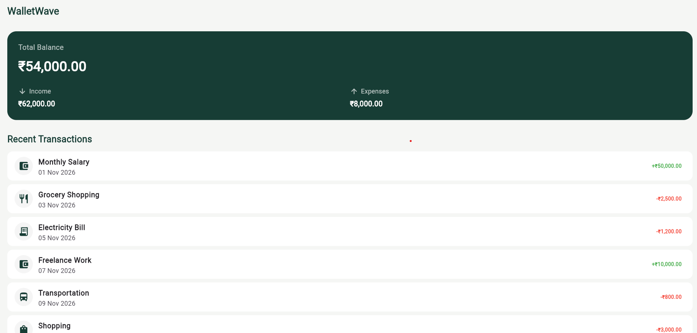
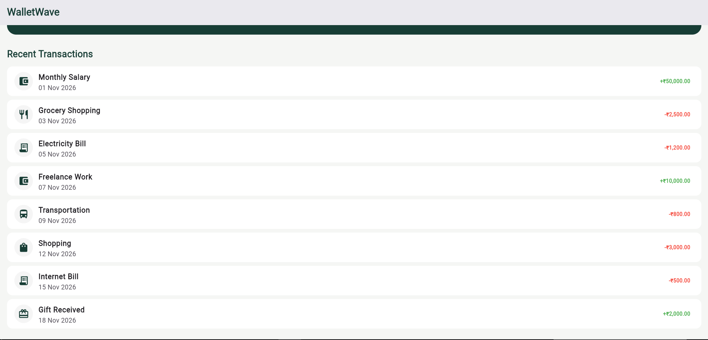
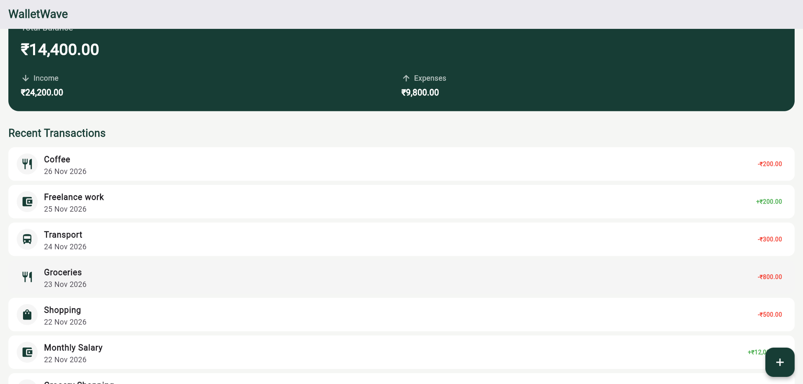
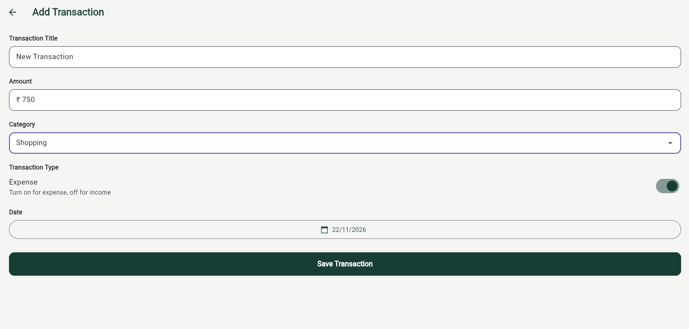
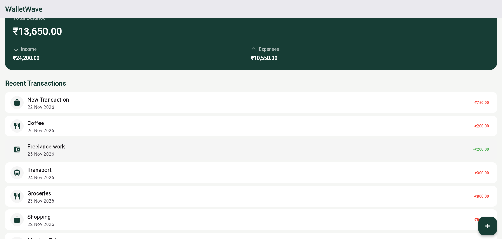
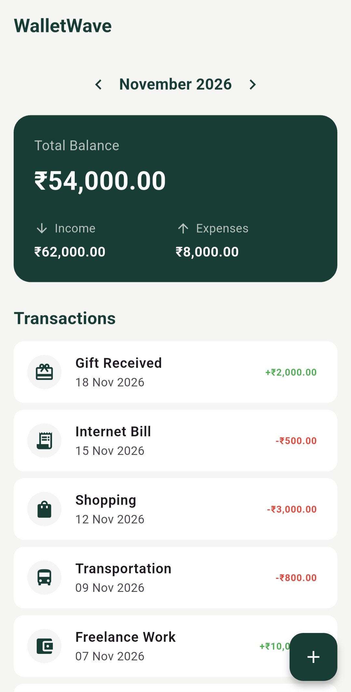
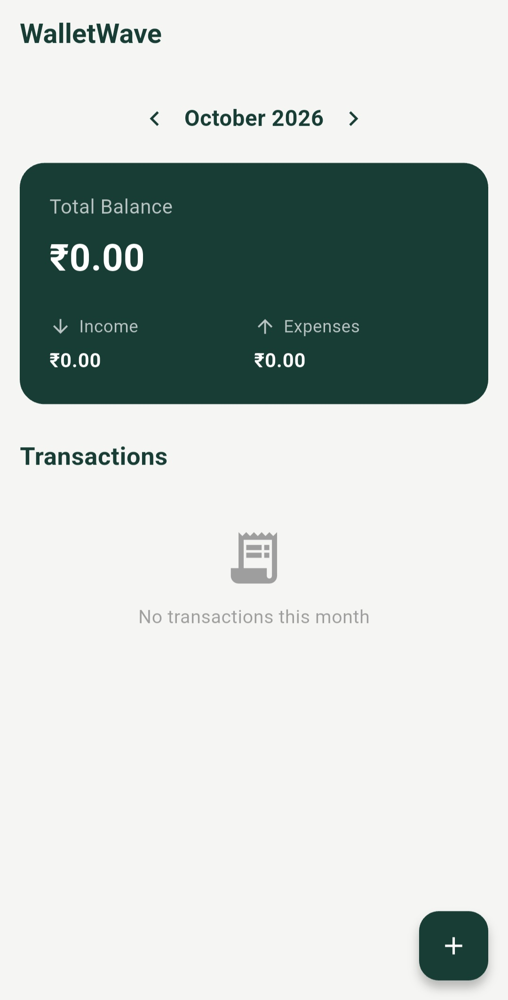
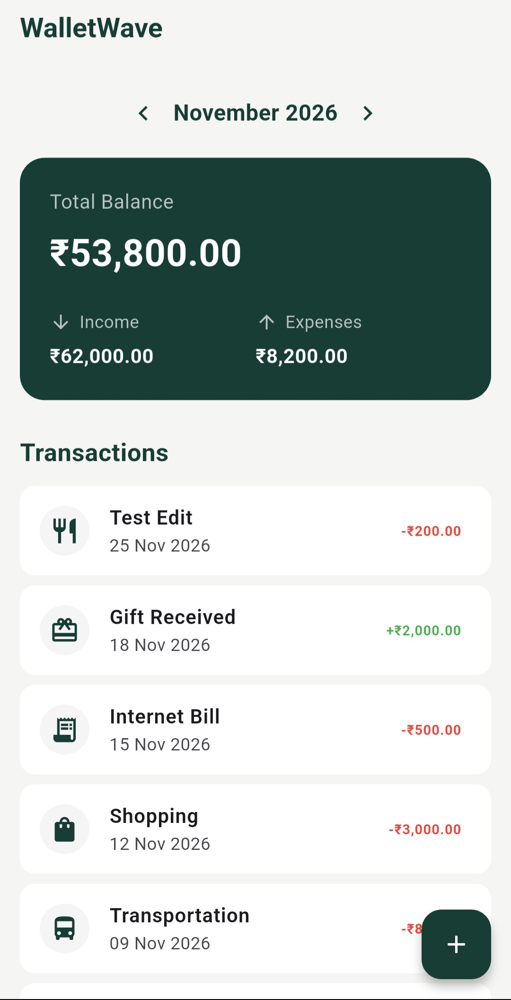

# WalletWave

Personal Finance & Smart Budget Tracker built with Flutter.

## Features

- Balance Dashboard
- Total Income and Expenses
- Transaction List
- Income and Expenses displayed with different colors
- Automatic balance calculation

## Technologies

- Flutter
- Dart
- intl package

## Getting Started

1. Clone the repository.
2. Open the project folder.
3. Run:

```bash
flutter pub get
flutter run
```

## Project Status

Week 1 - Balance Dashboard & Transaction List.

## Screenshots

### Dashboard - Part 1


### Dashboard - Part 2



## Week 2 – Add, Edit & Delete Transactions

### Dashboard


### Add Transaction


### Transaction Added


## Week 3 – Local Database & Monthly View

### New Features

- Local data storage using Hive.
- TransactionRepository for database operations.
- Transactions persist after closing and reopening the app.
- Add, edit, and delete transactions from local storage.
- Monthly transaction filtering.
- Monthly income, expenses, and balance calculations.
- Loading, empty, and error states.
- Undo deleted transactions.

### Technologies

- Flutter
- Dart
- Hive
- Hive Flutter
- intl

### Week 3 Screenshots

#### Monthly View


#### Empty Month


#### Data Persistence
